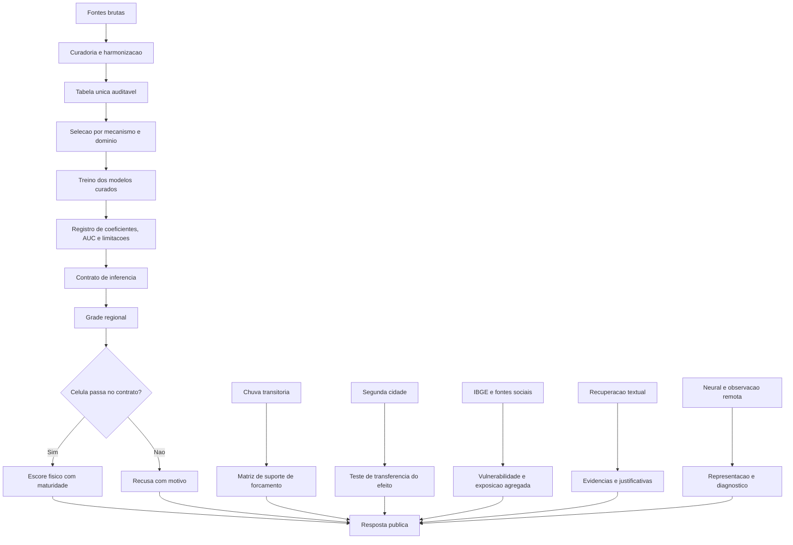

# Arquitetura

Este arquivo mostra como as partes se encaixam: o mapa das perguntas, o fluxo de dados,
a organizacao do codigo e o caminho que uma celula percorre ate virar resposta.

## 1. Mapa em arvore

```text
REV-P
├── 1. Pergunta cientifica
│   ├── Suscetibilidade fisica: onde o terreno favorece acumulo ou escoamento?
│   ├── Evidencia de evento: chuva ou registro observado sustenta o evento?
│   ├── Transferencia: o modelo usado e local, transferido ou sem referencia local?
│   └── Comunicacao: o que pode ser dito sem exagerar a evidencia?
│
├── 2. Dados
│   ├── Recife: pontos locais e chuva antecedente
│   ├── Curitiba: chamados e diagnostico local; servida por fluvial_planicie
│   ├── Petropolis: aplicacao por transferencia de serra, sem referencia local
│   ├── UK, CEMS, Sen1Floods11, UFO: evidencias externas e globais
│   ├── NYC e Sao Paulo: series urbanas para a frente pluvial e de evento
│   ├── Chicago: segunda cidade do teste de transferencia
│   └── IBGE Curitiba: vulnerabilidade e exposicao social agregada
│
├── 3. Camada fisica
│   ├── Variaveis: HAND, TWI D-infinity, declividade, elevacao relativa
│   ├── Recife inclui rain_decay_index
│   ├── Modelos: logistica com correcao de Firth ou regularizacao
│   └── Saida: escore fisico com intervalo, recusa e maturidade
│
├── 4. Contrato de inferencia
│   ├── Checa dominio e presenca de variaveis
│   ├── Se passa: calcula escore
│   ├── Se falha: recusa com motivo
│   └── Nao aceita promocao silenciosa por camada externa
│
├── 5. Grade e servico
│   ├── Geracao de celulas por regiao a 120 m
│   ├── Aplicacao do contrato em lote
│   ├── Conferencia contra o contrato
│   └── Entrega em CSV, GeoTIFF, PNG e resumo
│
├── 6. Validacao e suporte
│   ├── Validacao agrupada por celula, grupo ou bloco
│   ├── Bootstrap e intervalos por grupo
│   ├── Testes temporais quando possiveis
│   ├── Matriz de suporte cientifico
│   └── Testes automatizados de regressao
│
├── 7. Camadas auxiliares
│   ├── Social: vulnerabilidade e exposicao, sem alterar escore fisico
│   ├── Chuva: associacao evento-notificacao por autopareamento no tempo
│   ├── Transferencia: o mesmo estimador em duas cidades
│   ├── Recuperacao: busca lexical, densa e hibrida de evidencia textual
│   ├── Neural: representacao e abstinencia seletiva
│   └── Visual: revisao e representacao, nao motor causal servido
│
└── 8. Comunicacao
    ├── README e documentacao tecnica
    ├── Evidencia e limitacoes
    ├── Declaracoes permitidas e vedadas
    └── Roteiro de estudo
```

## 2. Fluxo operacional



Leitura correta do fluxo:

- a tabela unica alimenta o treino fisico;
- o treino gera coeficientes e criterios;
- o contrato decide se o escore pode ser servido;
- a grade aplica o contrato celula por celula;
- chuva, transferencia, social, recuperacao e neural acrescentam contexto ou
  diagnostico, e **nao mudam silenciosamente o escore fisico**.

## 3. Organizacao do codigo

```text
scripts/
├── treino/          consolidacao da tabela unica, desenho experimental e selecao
├── servico/         contrato, grade, resolucao de camadas, proveniencia, verificador
├── terreno/         cadeia fisico-hidrologica e auditoria regional
├── externo/         aquisicao e preparacao de fontes externas
├── chuva/           contrato de chuva, autopareamento e terreno sob gatilho
├── social/          camada social territorial e recorte do IBGE
├── temporalidade/   ontologia, auditoria e dimensao temporal
├── neural/          cadeia seletiva, regua estatistica e catraca
└── dino/            rotinas historicas de revisao visual, fora do contrato servido

modelo/
├── MODELO.md        cartao do modelo: pesos, dominio, maturidade, limitacoes
├── DADOS.md         ficha dos dados: esquema, contagens, regras de uso
└── execucoes/       uma pasta por execucao, com commands.txt e artefatos

docs/                metodo, evidencia, limitacoes, conceitos, arquitetura, validacao,
                     regioes, afirmacoes, fontes, estado atual, artefatos, roteiro

outputs_public/      pacote historico por estagio, anterior a esta organizacao

tests/               regressao da cadeia publica e integridade do proprio pacote
```

Cada pasta em `modelo/execucoes/` corresponde a uma execucao real e carrega o
`commands.txt` que a reproduz. Etapa que legitimamente nao cabe neste pacote se declara
com a linha `fora do pacote:` mais um `fora_do_pacote.md` explicando por que.

## 4. Responsabilidade de cada diretorio de codigo

| Diretorio | Responsabilidade | Regra que nao pode ser quebrada |
|---|---|---|
| `scripts/servico` | Motor de inferencia servido: contrato, grade, resposta | O contrato e o unico dono de portao, maturidade e extrapolacao |
| `scripts/treino` | Consolidacao, desenho experimental e selecao de modelos | Nao promove modelo sem passar pelos criterios declarados |
| `scripts/terreno` | Derivar e validar variaveis fisicas | Resolucao unica de 30 m; cadeia declarada por linha |
| `scripts/externo` | Adquirir e harmonizar fontes externas | Aquisicao amplia evidencia; nao muda peso nem promove modelo |
| `scripts/chuva` | Chuva antecedente, contrato proprio e forcamento de evento | Chuva antecedente e variavel so onde o contrato declara |
| `scripts/social` | Indicadores sociais por setor censitario | Nunca altera escore, nunca cria rotulo, ausencia nao e baixa vulnerabilidade |
| `scripts/temporalidade` | Ontologia e auditoria de suporte temporal | Preserva `inconclusive` e `not_testable` como estados distintos |
| `scripts/neural` | Representacao, regua estatistica e abstinencia | Resultado e demonstrativo; nao substitui o contrato |
| `scripts/dino` | Revisao visual historica | Nao participa do escore servido |

## 5. O caminho de uma celula

### 5.1 Entrada minima

Uma celula precisa carregar identificacao espacial, regiao, modelo ou maturidade
aplicavel, as variaveis fisicas exigidas pelo modelo, metadados de dominio, chuva
antecedente quando aplicavel, e rastreabilidade da fonte e do processamento.

### 5.2 Decisao

```text
entrada da celula
    ↓
G1  regiao declarada no contrato?
    ↓
G2  modelo regional marcado como servivel?
    ↓
G3  maturidade regional explicita?
    ↓
G4  todas as variaveis obrigatorias presentes?
    ↓
G5  dentro do dominio, ou marcado como extrapolacao?
    ↓
falhou: recusa com motivo   |   passou: escore fisico
    ↓
explicacao estruturada e saida
```

Os portoes rodam em ordem declarada. O primeiro que falha define o motivo da recusa, e
a resposta carrega esse motivo em vez de um valor.

### 5.3 Saida correta

| Campo | Por que e necessario |
|---|---|
| Escore fisico | Resultado numerico quando a inferencia e permitida. |
| Intervalo | Incerteza do proprio preditor, por bootstrap de grupos. |
| Maturidade | Impede leitura como validacao universal. |
| Modelo usado | Permite rastrear pesos e limitacoes. |
| Variaveis presentes | Permite auditar o calculo. |
| Distancia de dominio | Diz se o caso e interpolacao ou extrapolacao. |
| Motivo de recusa | Preserva seguranca quando nao ha inferencia. |
| Limitacoes | Comunica lacunas sem ocultar incerteza. |
| Contexto social ou de evento | Ajuda decisao publica sem virar causa fisica. |

A explicacao e gerada por REGRA sobre o payload ja decidido: a contribuicao de cada
variavel e `coeficiente padronizado x z(valor)`, medida no mesmo espaco em que o modelo
decide, e a frase so descreve o sinal dessa contribuicao. Variavel com sinal contrario
ao fisicamente esperado, ou com IC cruzando zero, entra no escore e **fica fora da
frase**.
